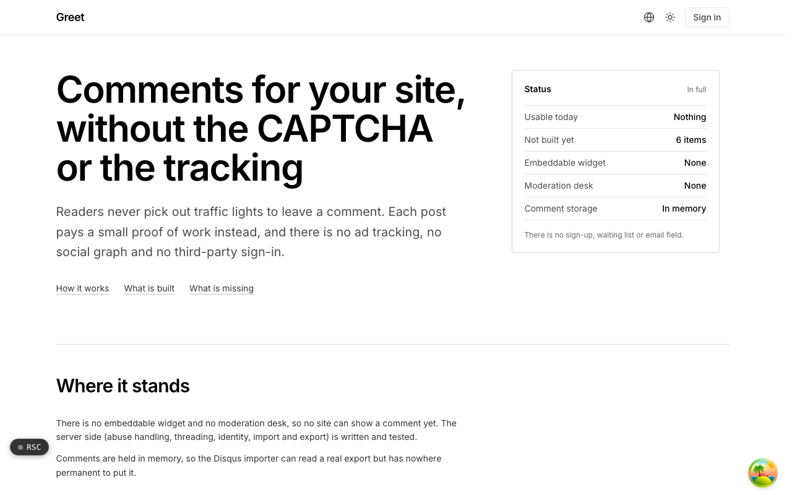

  <picture>
    <source media="(prefers-color-scheme: dark)" srcset=".github/assets/hero-dark.png">
    
  </picture>

# greet.me.at

Comments for your site, without the CAPTCHA or the tracking.

Greet is a comments and guestbook system for sites that do not want a social network attached: one embeddable widget, a moderation desk, and no ad tracking. Readers never solve a CAPTCHA to leave a comment. Each post pays a small proof of work instead, and there is no ad tracking, no social graph and no third-party sign-in. Greet is in active development, and its landing page says plainly what is usable today and what is still missing.

## Features

- **Proof of work instead of a CAPTCHA**: each submission carries a small proof of work, and a solution cannot be replayed.
- **Checks a reader never sees**: honeypot fields, fill-time analysis and content filters are weighed together to catch automated posts.
- **Rate limits that cover anonymous posters**: layered rate budgets are keyed so anonymous commenters are limited without needing an account.
- **Threads, edits and deletes**: threads have a maximum reply depth, and editing and deleting each have their own rules.
- **Anonymous posting, set per site**: each site decides whether anonymous comments are allowed.
- **Moderation model**: moderation states, a review queue, an audit trail and moderator grants for the sites you own.
- **No-store modes**: show a thread from a Bluesky post or GitHub Discussions without Greet storing the comments.
- **Leave whenever you like**: Disqus XML import, and export with every kind of stored personal data listed and redacted.

## Built with

- Next.js 16 (App Router), React 19, TypeScript
- Tailwind CSS 4
- oRPC for the typed API
- Better Auth (the shared me.at account)
- unified / remark for comment markdown
- Self-hostable build generated from the same source as the hosted one

## Part of the me.at family

greet.me.at is one of my [`*.me.at`](https://me.at) apps. They share one design system, account, and app shell. Development happens in a private monorepo; this repository is the project's public-facing home.

## License

See [LICENSE](LICENSE).
