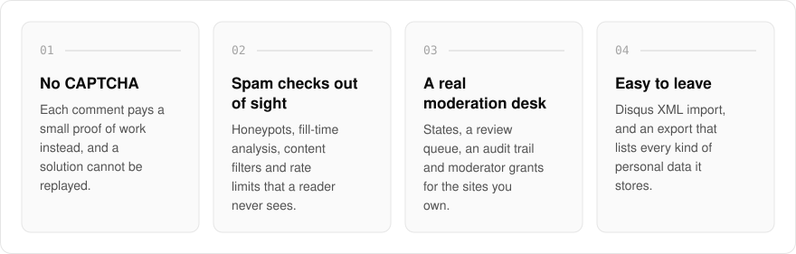
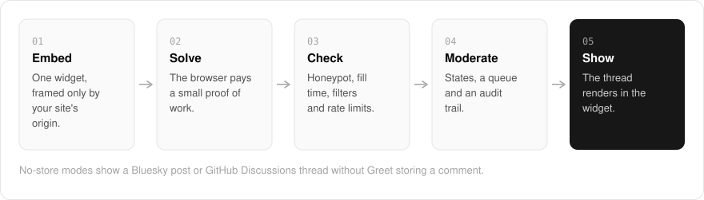

  <picture>
    <source media="(prefers-color-scheme: dark)" srcset=".github/assets/hero-dark.png">
    
  </picture>

<h1 align="center">greet.me.at</h1>

<strong>Comments for your site, without the CAPTCHA or the tracking.</strong>

  
  
  
  

  <a href="#features">Features</a> ·
  <a href="#how-it-works">How it works</a> ·
  <a href="#built-with">Built with</a>

Adding comments to a site usually means adding a CAPTCHA, an ad tracker and someone else's social network along with them. I built greet.me.at as comments and a guestbook without any of that: one embeddable widget, a moderation desk, and no ad tracking, social graph or third-party sign-in. Readers never solve a puzzle to leave a comment, because each post pays a small proof of work instead. Greet is in active development, and its landing page says plainly what is usable today and what is still missing.

  <picture>
    <source media="(prefers-color-scheme: dark)" srcset=".github/assets/overview-dark.svg">
    
  </picture>

## Why greet.me.at

| The usual comment widget | greet.me.at |
| --- | --- |
| A CAPTCHA puzzle for every reader | A small proof of work, with nothing to solve |
| Ad tracking and a social graph attached | No ad tracking, no social graph, no third-party sign-in |
| Anonymous comments all on or all off | Anonymous posting is set per site |
| Your comments are hard to take with you | Disqus import, and an export listing every kind of personal data |

## Features

- **Proof of work instead of a CAPTCHA**: each submission carries a small proof of work, and a solution cannot be replayed.
- **Checks a reader never sees**: honeypot fields, fill-time analysis and content filters are weighed together to catch automated posts.
- **Rate limits that cover anonymous posters**: layered rate budgets are keyed so anonymous commenters are limited without needing an account.
- **Threads, edits and deletes**: threads have a maximum reply depth, and editing and deleting each have their own rules.
- **Anonymous posting, set per site**: each site decides whether anonymous comments are allowed.
- **Moderation model**: moderation states, a review queue, an audit trail and moderator grants for the sites you own.
- **No-store modes**: show a thread from a Bluesky post or GitHub Discussions without Greet storing the comments.
- **Leave whenever you like**: Disqus XML import, and export with every kind of stored personal data listed and redacted.

## How it works

  <picture>
    <source media="(prefers-color-scheme: dark)" srcset=".github/assets/flow-dark.svg">
    
  </picture>

The widget is embedded on your page and can only be framed by your site's registered origin. When a reader posts, the browser pays a small proof of work, and the server weighs honeypot fields, fill time, content filters and rate budgets before the comment reaches its moderation state. Visible comments render in the thread, and every moderator action lands in the audit trail.

## Built with

  
  
  
  
  

- Next.js 16 (App Router), React 19, TypeScript
- Tailwind CSS 4
- oRPC for the typed API
- Better Auth (the shared me.at account)
- unified / remark for comment markdown
- Self-hostable build generated from the same source as the hosted one

## Part of the me.at family

greet.me.at is one of my [`*.me.at`](https://me.at) apps. They share one design system, account, and app shell. Development happens in a private monorepo; this repository is the project's public-facing home.

## License

Source-available. See [LICENSE](LICENSE).
